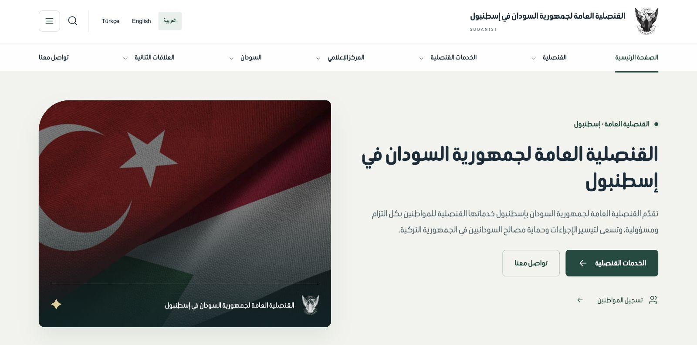
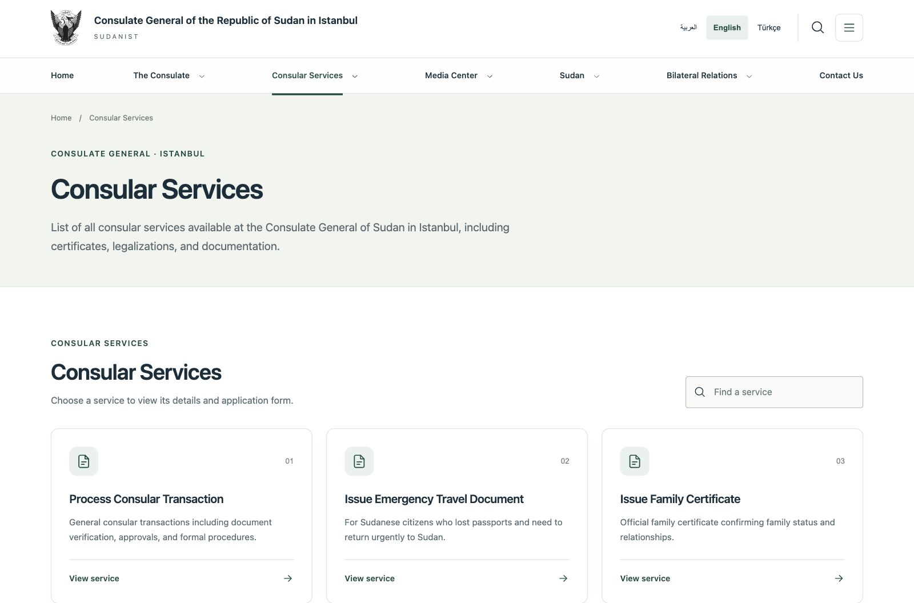
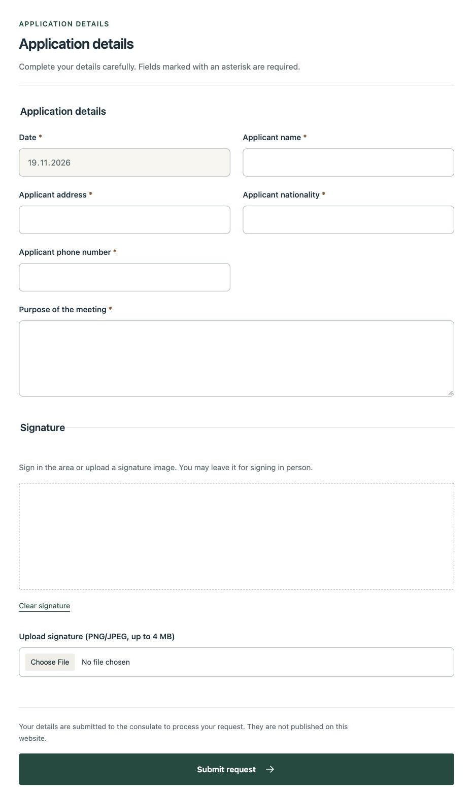
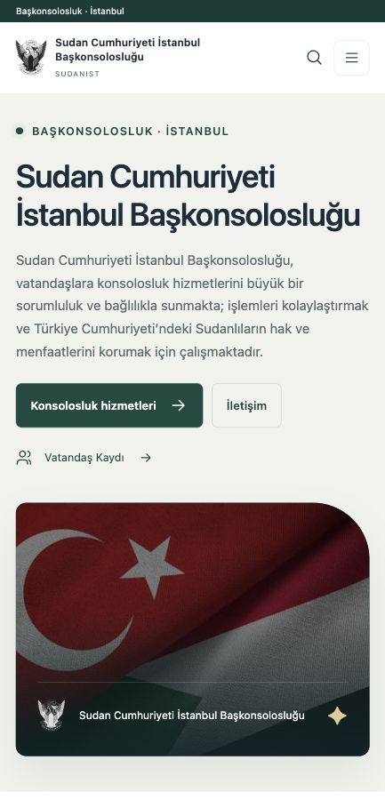
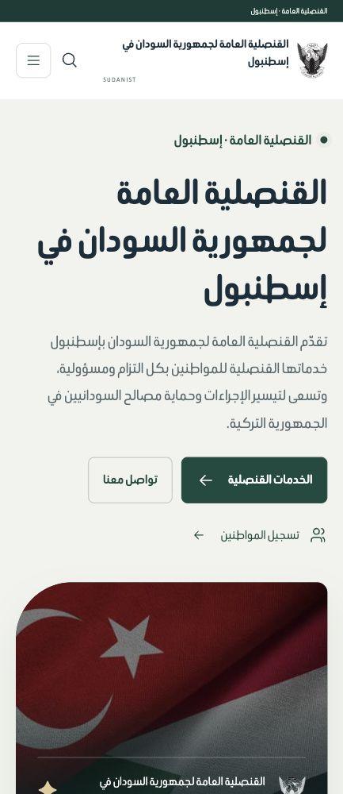

# القنصلية العامة لجمهورية السودان في إسطنبول — عرض المشروع

[English](README.md) · [Türkçe](README.tr.md) · [العربية](README.ar.md)

**مشروع لعميل · الموقع يعمل · Web · AR / EN / TR**

يجمع SudanIST المعلومات القنصلية بالعربية والإنجليزية والتركية، والنماذج المخصصة للخدمات، وإدارة المحتوى للموظفين في موقع متجاوب واحد.

## من منظور العميل

ينبغي أن تخدم المعلومات والنماذج القنصلية أشخاصًا يقرؤون بلغات مختلفة ولديهم متطلبات مستندية متباينة، مع إبقاء بياناتهم ضمن مسار عمل الموظفين المخولين. هذا توصيف مستنتج من نطاق البرمجية؛ لم تُقدَّم مقابلة مع العميل أو بيانات مرجعية مقاسة.

يجمع موقع واحد تُنشأ صفحاته على الخادم الإرشادات المترجمة ودليل خدمات قابلًا للتصفية ونماذج مخصصة وإدارة محتوى متعددة اللغات ومراجعة للموظفين. وتختلف حدود الوصول إلى المحتوى العام عن حدود الوصول إلى السجلات الخاصة.

1. اختيار اللغة والعثور على الخدمة المناسبة.
2. قراءة الإرشادات وتعبئة النموذج المخصص للخدمة.
3. يتضمن التنفيذ التحقق من الطلب وحفظه وإعداد إشعار استلامه.
4. يمكن للموظف المخول مراجعة السجل وتحديث حالة المتابعة الداخلية.

## نطاق التسليم

- موقع عام بالعربية والإنجليزية والتركية
- دليل خدمات متجاوب ونماذج طلبات
- مساحة للموظفين لإدارة المحتوى والطلبات
- إشعارات استلام بصيغة PDF وضوابط وصول للمستندات مثبتة في الشفرة

القدرة المسلّمة هي موقع يعمل بثلاث لغات للمعلومات واستقبال الطلبات، مع مساحة محتوى تتطلب تسجيل الدخول. تتحقق هذه المراجعة من واجهات ممثلة ومن وجود التنفيذ في الشفرة. ولا تثبت إتمام مواعيد أو صدور موافقات قانونية أو دفع رسوم أو حجم استخدام أو انخفاض زمن المعالجة.

## من المنظور الهندسي

يستخدم التطبيق الذي خضع للفحص PHP لإنشاء الصفحات على الخادم، وPDO للوصول إلى قاعدة بيانات متوافقة مع MySQL، وJavaScript وCSS مخصصين، وmPDF لإنتاج ملفات PDF. تشترك الواجهات العامة وعمليات الموظفين في خدمات التطبيق مع اختلاف قواعد الوصول. تساعد القوالب وأنواع كتل المحتوى المسموح بها على اتساق الصفحات، وتحافظ السجلات الرئيسية والفرعية المخصصة للخدمات على معنى البيانات المتكررة. لم يُعثر على واجهة API عامة ذات إصدارات مستقلة أو طابور رسائل أو عميل أصلي.

- نموذج محتوى مشترك يدعم ثلاث لغات واتجاهَي القراءة.
- لكل خدمة حقولها وسجلاتها المرتبطة.
- تُراعى حالة النشر في اكتشاف المحتوى ومخرجات محركات البحث.
- للمستندات الخاصة وإشعارات الاستلام ضوابط وصول مستقلة عن المحتوى العام.

تمت معاينة الصفحات العامة وتصفية الدليل والدخول التجريبي ومحرر فارغ. روجعت استمرارية حفظ الطلب وإنتاج PDF وانتقالات المراجعة في الشفرة دون تشغيلها على السجلات الحية. لا تُدّعى مؤشرات نتائج تجارية.

## اللغات وتجربة الاستخدام

تُعرض العربية من اليمين إلى اليسار، والإنجليزية والتركية من اليسار إلى اليمين. وتعمل قواميس الواجهة إلى جانب سجلات المحتوى المترجمة. تستخدم الواجهة الحالية CSS مخصصًا ومسافات منطقية وشبكات متجاوبة وقائمة جانبية للشاشات الضيقة، مع خط عربي محلي. التُقطت صور للعربية والإنجليزية على سطح المكتب، وللعربية والتركية في عرض ضيق. توجد في الشفرة روابط لتجاوز التنقل وأنماط للتركيز ودعم لتقليل الحركة، لكن المراجعة لا تمنح شهادة إتاحة ولا تغطي جميع المتصفحات والأجهزة.

## شاشات حقيقية مختارة

صور حقيقية من الواجهة العامة الحية، التُقطت في 19 نوفمبر 2026 وقُصّت لحماية الخصوصية. لا تحتوي النماذج الفارغة على بيانات طلبات مرسلة.

دليل الخدمات بالإنجليزية مع المرشح وبطاقات خدمات ممثلة.

نموذج طلب مقابلة فارغ مع حقول مقدم الطلب ومساحة توقيع خالية؛ لم يُرسل طلب.

الصفحة الرئيسية التركية في عرض متصفح ضيق مع محتوى مرتب رأسيًا.

الصفحة الرئيسية العربية في عرض ضيق مع نص وتنقل من اليمين إلى اليسار.

## بيانات المشروع

- العميل: Ammar Al-Samani.
- فترة العمل: يناير–مارس 2026 (بحسب صاحب المشروع؛ بدقة الشهر).
- هذا العمل مشروع منفّذ لعميل. عرضه عبر Ideabat لا ينقل ملكية العميل ولا يتيح الشفرة المصدرية للتطبيق. وتبقى القرارات القنصلية من اختصاص الجهة المسؤولة.

يُنسب التطوير التقني للمشروع إلى Ideabat. ويشمل التسليم الذي خضع للفحص الموقع العام والواجهة المترجمة وخدمات استقبال الطلبات وشفرة الإدارة. لم يُقدَّم سجل مساهمات مفصل لكل مرحلة أو عقد يحدد نقل حقوق الملكية الفكرية.

## الروابط الرسمية وصفحات Ideabat

[الموقع الحي](https://sudanist.com/)

تم التحقق من أن صفحات Ideabat الست تعمل في 19 نوفمبر 2026. لم يُرفع هذا التحديث المحلي للتوثيق.

**صفحة المشروع:** [English](https://ideabat.com/portfolio/sudanist-consular-services-platform/) · [Türkçe](https://ideabat.com/tr/portfolio/sudanist-consular-services-platform/) · [العربية](https://ideabat.com/ar/portfolio/sudanist-consular-services-platform/)

**دراسة الحالة:** [English](https://ideabat.com/case-study/sudanist-digital-consular-request-intake/) · [Türkçe](https://ideabat.com/tr/case-study/sudanist-digital-consular-request-intake/) · [العربية](https://ideabat.com/ar/case-study/sudanist-digital-consular-request-intake/)

## الملكية والمراجعة التقنية

يحتوي هذا المستودع على توثيق ومواد مرئية مصرح بها، وليس إصدارًا للشفرة المصدرية للتطبيق. عرض المشروع عبر Ideabat لا ينقل ملكية العميل. للاستفسارات المتعلقة بفرص العمل أو التعاون أو المراجعة التقنية، يُرجى التواصل مع Ragıp Mullamusa عبر Ideabat. يتطلب الوصول إلى الشفرة المملوكة للعميل إذنًا مسبقًا من صاحب المشروع والالتزام بمتطلبات السرية المعمول بها. تُراجع الطلبات كلٌّ على حدة، ولا يُضمن إتاحة الشفرة. ولا يمنح هذا العرض أي ترخيص للبرمجيات أو إذن بإعادة توزيعها.

Ragıp Mullamusa هو مؤسس [Ideabat](https://ideabat.com/). للاستفسارات ذات الصلة بالهندسة أو فرص العمل أو التعاون، يُرجى استخدام [صفحة التواصل](https://ideabat.com/contact-us/) أو البريد [info@ideabat.com](mailto:info@ideabat.com).

