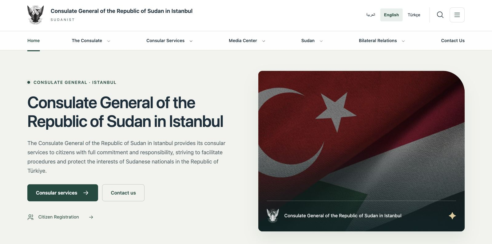
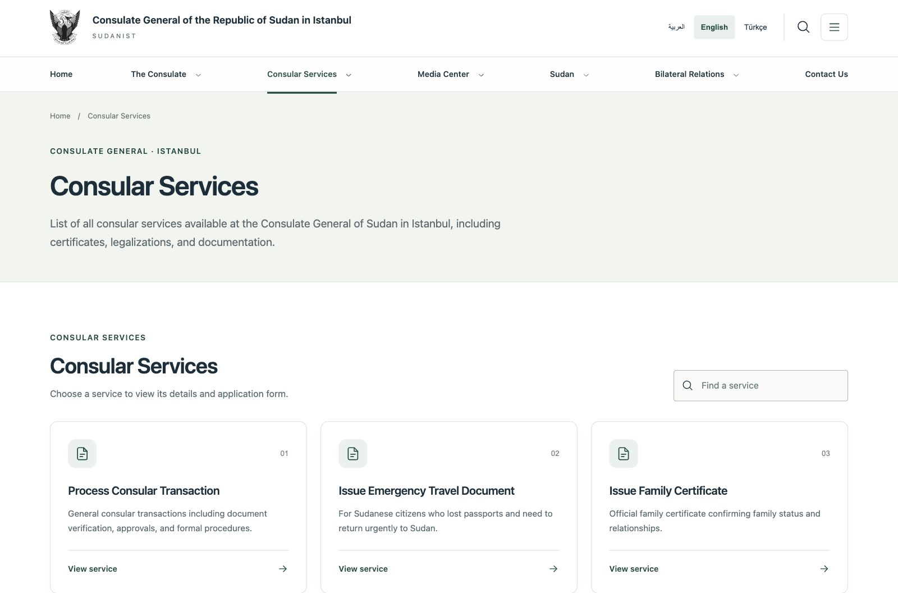
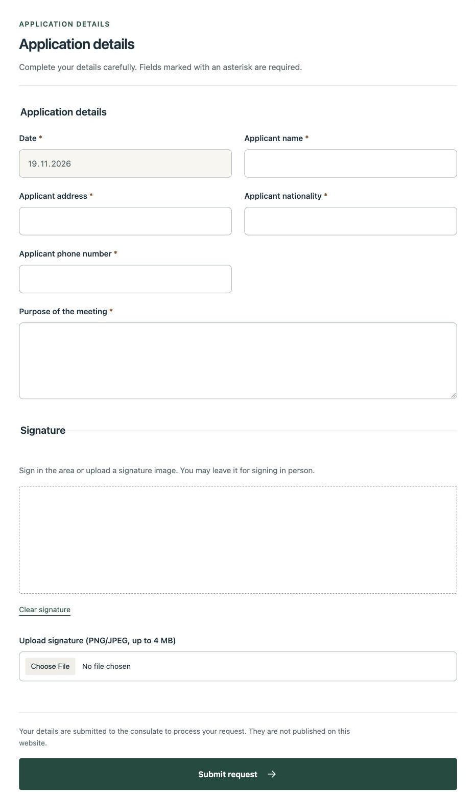
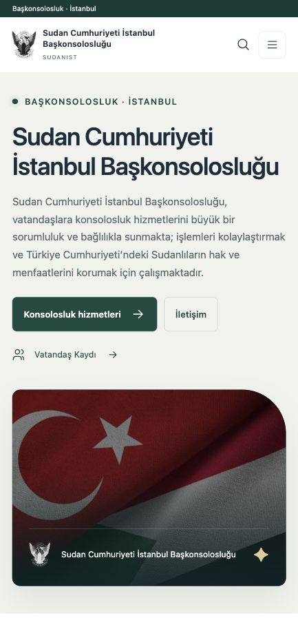
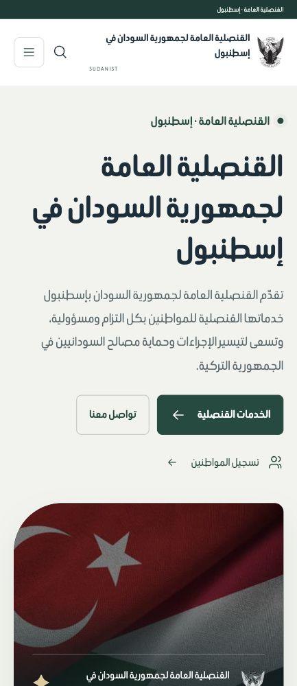

# Consulate General of the Republic of Sudan in Istanbul — Project Showcase

[English](README.md) · [Türkçe](README.tr.md) · [العربية](README.ar.md)

**Client project · Live · Web · AR / EN / TR**

SudanIST brings Arabic, English and Turkish consular information, service-specific forms and staff content administration into one responsive website.

## Customer view

Consular information and service forms need to serve readers with different languages and different document requirements, while keeping applicant details within an authorized staff workflow. This challenge is inferred from the delivered software; no client interview or measured baseline was supplied.

One server-rendered website combines localized guidance, a searchable service catalogue, service-specific forms, a multilingual CMS and controlled staff review. Public presentation and private records have distinct access boundaries.

1. Choose a language and locate the relevant service.
2. Read the guidance and complete the service-specific form.
3. The implementation validates and stores the request and prepares an application receipt.
4. Authorized staff can review the record and maintain internal processing state.

## Delivered scope

- Arabic, English and Turkish public website
- Responsive service catalogue and request forms
- Staff content and request-management workspace
- Source-verified PDF receipts and document-access controls

The delivered capability is a live trilingual information and intake website with an authenticated content workspace. This review verifies representative interfaces and source implementation. It does not establish completed appointments, legal approval, payment, adoption or faster processing.

## Engineering view

The inspected application is server-rendered PHP with PDO access to a MySQL-compatible database, custom JavaScript and CSS, and mPDF for PDF rendering. Public content and staff operations share application services, while their access rules differ. Content templates and approved block types keep page composition consistent. Service-specific parent and child records preserve the meaning of repeatable data. No independently versioned public API, message queue or native client was found.

- A shared content model supports three languages with RTL/LTR presentation.
- Different services retain their own fields and related records.
- Publication state is checked across content discovery and SEO outputs.
- Private documents and application receipts use access controls separate from public content.

Public pages, catalogue filtering, test login and an empty editor were observed. Request persistence, PDF generation and review transitions were inspected in source, not exercised on live records. No business KPIs are claimed.

## Languages and experience

Arabic uses RTL layout, while English and Turkish use LTR. Language dictionaries sit alongside translated content records. The current interface uses custom CSS, logical spacing, responsive grids and a narrow-screen navigation drawer. A local Arabic font supports the public identity. Desktop Arabic/English and narrow Turkish/Arabic pages were captured. Skip links, focus styles and reduced-motion support are present in source; this review does not certify accessibility conformance or every browser/device combination.

## Selected real screens

Real live public UI, captured 19 November 2026 and cropped for privacy. Empty forms contain no submitted applicant data.

English service catalogue showing its filter and representative service cards.

Empty meeting-request form with applicant fields and an unsigned signature area; no request submitted.

Turkish homepage in a narrow browser viewport with stacked content.

Arabic homepage in a narrow browser viewport with RTL text and navigation.

## Project facts

- Client: Ammar Al-Samani.
- Project window: January–March 2026 (owner supplied; month precision).
- This is a client delivery. Presentation through Ideabat does not transfer client ownership or release application source. Consular decisions remain with the responsible institution.

Ideabat is credited with the project’s technical development. The inspected delivery includes the public website, localized interface, intake services and administration code. A phase-by-phase authorship record and contractual IP assignment were not supplied.

## Official links and Ideabat pages

[Live website](https://sudanist.com/)

All six Ideabat pages were live verified on 19 November 2026. This local documentation update has not been uploaded.

**Portfolio:** [English](https://ideabat.com/portfolio/sudanist-consular-services-platform/) · [Türkçe](https://ideabat.com/tr/portfolio/sudanist-consular-services-platform/) · [العربية](https://ideabat.com/ar/portfolio/sudanist-consular-services-platform/)

**Case study:** [English](https://ideabat.com/case-study/sudanist-digital-consular-request-intake/) · [Türkçe](https://ideabat.com/tr/case-study/sudanist-digital-consular-request-intake/) · [العربية](https://ideabat.com/ar/case-study/sudanist-digital-consular-request-intake/)

## Ownership and technical review

This repository contains documentation and approved visual material, not an application source release. Presentation through Ideabat does not transfer a client's ownership. For employment, collaboration or technical-review inquiries, contact Ragıp Mullamusa through Ideabat. Access to client-owned source requires prior permission from the project owner and compliance with applicable confidentiality requirements. Requests are reviewed individually; source access is not guaranteed. No software license or redistribution permission is granted by this showcase.

Ragıp Mullamusa is the founder of [Ideabat](https://ideabat.com/). For relevant engineering, employment or collaboration inquiries, use [the contact page](https://ideabat.com/contact-us/) or [info@ideabat.com](mailto:info@ideabat.com).
