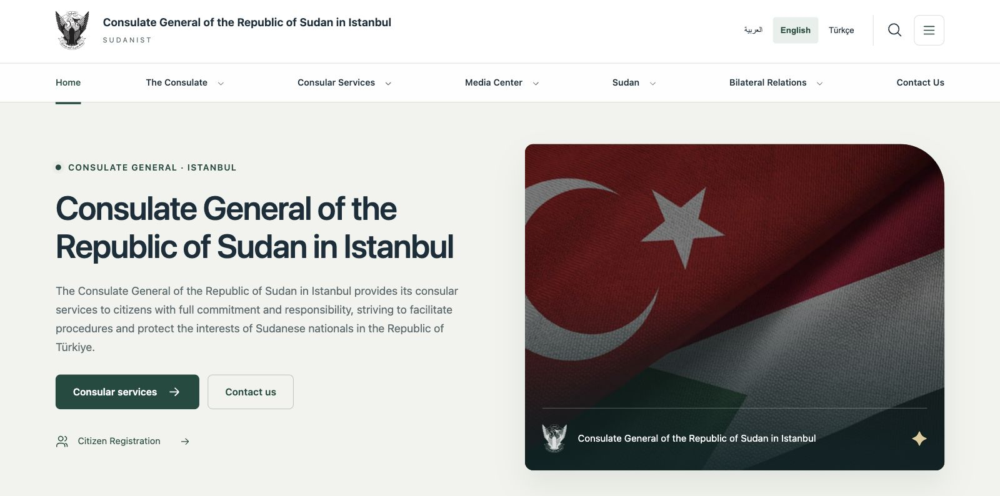
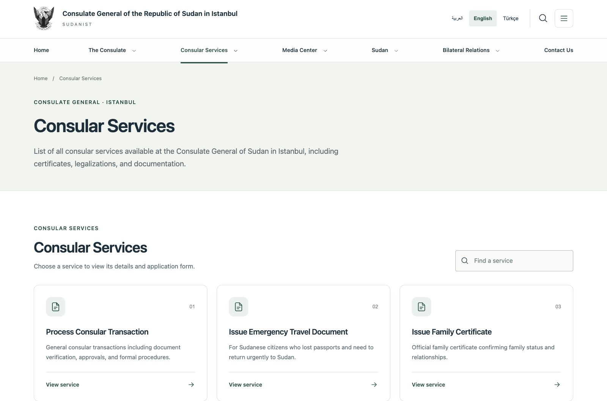
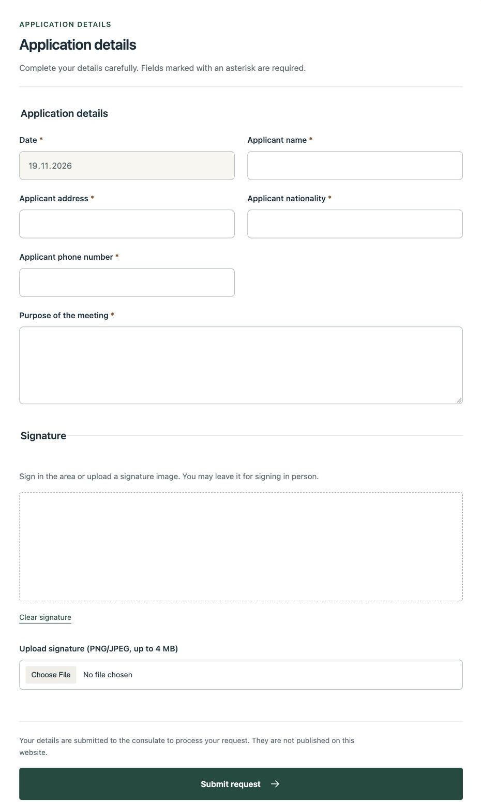
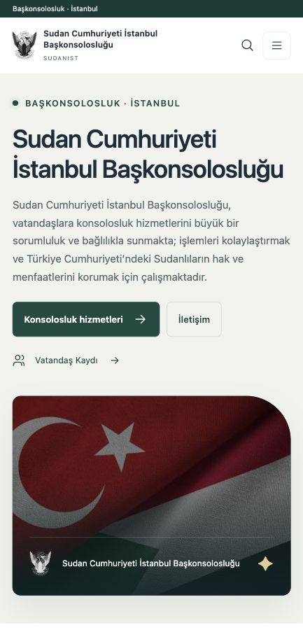
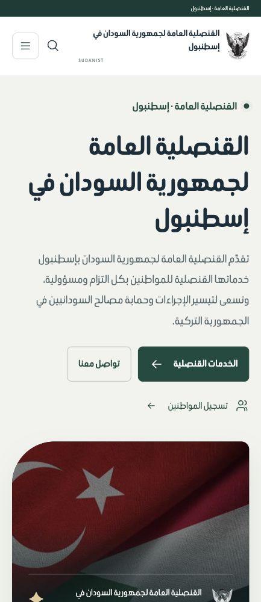

# Sudan Cumhuriyeti İstanbul Başkonsolosluğu — Proje Tanıtımı

[English](README.md) · [Türkçe](README.tr.md) · [العربية](README.ar.md)

**Müşteri projesi · Yayında · Web · AR / EN / TR**

SudanIST; Arapça, İngilizce ve Türkçe konsolosluk bilgilerini, hizmete özel başvuru formlarını ve personel içerik yönetimini duyarlı bir web sitesinde bir araya getirir.

## Müşteri açısından

Konsolosluk bilgileri ve formları, farklı dillerde okuyan ve farklı belge gereksinimleri bulunan kişilere hitap ederken başvuru verilerini yetkili personelin iş akışında tutmalıdır. Bu ihtiyaç teslim edilen yazılımdan çıkarılmıştır; müşteri görüşmesi veya ölçülmüş bir başlangıç verisi sunulmamıştır.

Sunucu tarafında oluşturulan tek bir web sitesi; yerelleştirilmiş bilgileri, filtrelenebilir hizmet kataloğunu, hizmete özel formları, çok dilli içerik yönetimini ve yetkili personel incelemesini birleştirir. Kamusal içerik ile özel kayıtların erişim sınırları ayrıdır.

1. Dili seçin ve ilgili hizmeti bulun.
2. Açıklamaları okuyun ve hizmete özel formu doldurun.
3. Uygulama, talebi doğrulamak, kaydetmek ve başvuru alındısı hazırlamak üzere geliştirilmiştir.
4. Yetkili personel kaydı inceleyebilir ve kurum içi işlem durumunu yönetebilir.

## Teslimat kapsamı

- Arapça, İngilizce ve Türkçe kamusal web sitesi
- Duyarlı hizmet kataloğu ve başvuru formları
- Personel için içerik ve talep yönetimi alanı
- Kaynak kodda doğrulanan PDF alındıları ve belge erişim kontrolleri

Teslim edilen yetenek, yayındaki üç dilli bilgi ve başvuru sitesi ile kimlik doğrulamalı içerik çalışma alanıdır. Bu inceleme, temsili arayüzleri ve kaynak kod uygulamasını doğrular. Tamamlanmış randevu, resmî onay, ödeme, kullanım düzeyi veya işlem süresinde azalma sonucunu ortaya koymaz.

## Mühendislik açısından

İncelenen uygulama; MySQL uyumlu veritabanına PDO ile erişen, sunucu tarafında sayfa oluşturan PHP, özel JavaScript ve CSS ile PDF üretimi için mPDF kullanır. Kamusal içerik ile personel işlemleri ortak servislerden yararlanır, ancak erişim kuralları farklıdır. Şablonlar ve izin verilen içerik blokları sayfa yapısını düzenler. Hizmete özel ana ve alt kayıtlar tekrarlanan verilerin anlamını korur. Bağımsız sürümlenen bir genel API, mesaj kuyruğu veya yerel uygulama istemcisi bulunmamıştır.

- Ortak içerik modeli, RTL/LTR sunumuyla üç dili destekler.
- Her hizmet kendi alanlarını ve ilişkili kayıtlarını korur.
- Yayın durumu, içerik keşfi ve SEO çıktılarında kontrol edilir.
- Özel belgeler ve başvuru alındıları, kamusal içerikten ayrı erişim kurallarına sahiptir.

Kamusal sayfalar, katalog filtresi, test hesabıyla giriş ve boş düzenleyici gözlemlendi. Talep kaydı, PDF üretimi ve inceleme geçişleri canlı kayıtlarda çalıştırılmadan kaynak kodda incelendi. İş sonucu metriği iddia edilmez.

## Diller ve deneyim

Arapça RTL, İngilizce ve Türkçe LTR düzen kullanır. Dil sözlükleri, çevrilmiş içerik kayıtlarıyla birlikte çalışır. Mevcut arayüz özel CSS, mantıksal boşluk özellikleri, duyarlı ızgaralar ve dar ekranda açılan gezinme çekmecesi kullanır. Yerel Arapça yazı tipi kurumsal sunumu destekler. Masaüstünde Arapça/İngilizce, dar görünümde Türkçe/Arapça ekranlar yakalandı. Kaynakta içeriğe geç bağlantıları, odak stilleri ve azaltılmış hareket desteği vardır; bu inceleme erişilebilirlik uygunluğu veya tüm cihazlarda uyumluluk sertifikası değildir.

## Gerçek ekranlardan seçkiler

19 Kasım 2026’da canlı kamusal arayüzden alınmış, gizlilik için kırpılmış gerçek görüntülerdir. Boş formlar gönderilmiş başvuran verisi içermez.

Filtreyi ve örnek hizmet kartlarını gösteren İngilizce hizmet kataloğu.

Başvuran alanları ve boş imza alanıyla görüşme talebi formu; başvuru gönderilmedi.

Dar tarayıcı görünümünde alt alta yerleşen içerikleriyle Türkçe ana sayfa.

Dar tarayıcı görünümünde sağdan sola metin ve gezinmeyle Arapça ana sayfa.

## Proje bilgileri

- Müşteri: Ammar Al-Samani.
- Çalışma aralığı: Ocak–Mart 2026 (proje sahibinin beyanı; ay düzeyinde).
- Bu çalışma bir müşteri teslimatıdır. Ideabat üzerinden tanıtılması müşterinin mülkiyetini devretmez ve uygulama kaynak kodunu yayıma açmaz. Konsolosluk kararları yetkili kurumun sorumluluğundadır.

Projenin teknik geliştirmesi Ideabat’a atfedilmektedir. İncelenen teslimat; kamusal web sitesini, yerelleştirilmiş arayüzü, başvuru servislerini ve yönetim kodunu içerir. Aşama bazında katkı dökümü ve sözleşmesel fikrî hak devri belgesi sunulmamıştır.

## Resmî bağlantılar ve Ideabat sayfaları

[Yayındaki web sitesi](https://sudanist.com/)

Altı Ideabat sayfasının da 19 Kasım 2026’da yayında olduğu doğrulandı. Bu yerel dokümantasyon güncellemesi yüklenmedi.

**Portföy:** [English](https://ideabat.com/portfolio/sudanist-consular-services-platform/) · [Türkçe](https://ideabat.com/tr/portfolio/sudanist-consular-services-platform/) · [العربية](https://ideabat.com/ar/portfolio/sudanist-consular-services-platform/)

**Vaka çalışması:** [English](https://ideabat.com/case-study/sudanist-digital-consular-request-intake/) · [Türkçe](https://ideabat.com/tr/case-study/sudanist-digital-consular-request-intake/) · [العربية](https://ideabat.com/ar/case-study/sudanist-digital-consular-request-intake/)

## Mülkiyet ve teknik inceleme

Bu depo, uygulamanın kaynak kodu yayını değil; dokümantasyon ve izin verilmiş görsel materyal içerir. Ideabat üzerinden tanıtılması müşterinin mülkiyet haklarını devretmez. İş fırsatları, iş birliği veya teknik inceleme talepleri için Ideabat aracılığıyla Ragıp Mullamusa ile iletişime geçebilirsiniz. Müşteriye ait kaynak koda erişim, proje sahibinin önceden iznine ve geçerli gizlilik şartlarına uyulmasına bağlıdır. Talepler ayrı ayrı değerlendirilir; kaynak koda erişim garanti edilmez. Bu tanıtım herhangi bir yazılım lisansı veya yeniden dağıtım izni vermez.

Ragıp Mullamusa, [Ideabat](https://ideabat.com/)'ın kurucusudur. İlgili mühendislik, iş fırsatı veya iş birliği talepleri için [iletişim sayfasını](https://ideabat.com/contact-us/) ya da [info@ideabat.com](mailto:info@ideabat.com) adresini kullanabilirsiniz.
